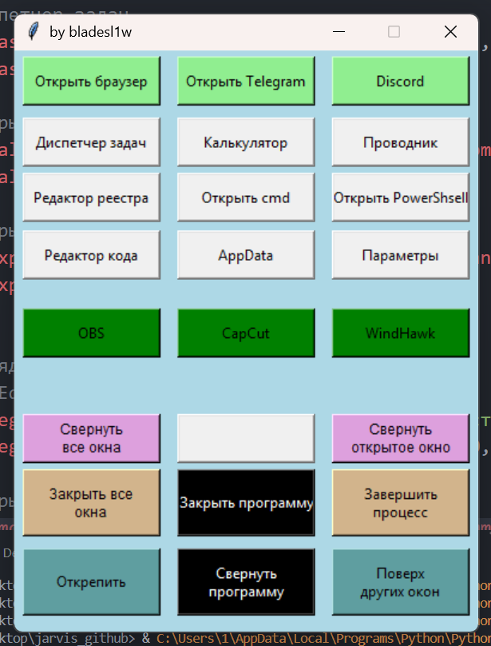

# Helper



Небольшая утилита для Windows: панель с кнопками для быстрого запуска приложений и управления окнами. Каждая кнопка кликабельна и выполняет своё действие в один клик.

Автор: **bladesl1w**

## Интерфейс

Окно разделено на цветные группы кнопок (3 колонки).

### Быстрый запуск (зелёные)

| Кнопка | Действие |
|---|---|
| Открыть браузер | Открывает браузер по умолчанию; если он уже запущен, выводит его окно на передний план |
| Открыть Telegram | Запускает Telegram |
| Discord | Запускает Discord |

### Системные программы (светлые)

| Кнопка | Действие |
|---|---|
| Диспетчер задач | Открывает диспетчер задач |
| Калькулятор | Открывает калькулятор |
| Проводник | Открывает проводник |
| Редактор реестра | Открывает `regedit` |
| Открыть cmd | Открывает командную строку |
| Открыть PowerShell | Открывает PowerShell |
| Редактор кода | Открывает редактор кода |
| AppData | Открывает папку `AppData` |
| Параметры | Открывает «Параметры» Windows |

### Программы для работы (тёмно-зелёные)

| Кнопка | Действие |
|---|---|
| OBS | Запускает OBS |
| CapCut | Запускает CapCut |
| WindHawk | Запускает WindHawk |

### Управление окнами

| Кнопка | Действие |
|---|---|
| Свернуть все окна | Сворачивает все окна |
| Свернуть открытое окно | Сворачивает верхнее открытое окно (не окно программы) |
| Закрыть все окна | Закрывает пользовательские процессы (с предупреждением о несохранённых данных), кроме системных и самой программы |
| Завершить процесс | Принудительно завершает выбранный процесс |
| Открепить | Снимает закрепление окна программы |
| Поверх других окон | Закрепляет окно программы поверх остальных |

### Управление программой (чёрные)

| Кнопка | Действие |
|---|---|
| Закрыть программу | Закрывает Helper |
| Свернуть программу | Сворачивает окно Helper |

> Пустая кнопка в центре ряда «Свернуть все окна» пока не используется.

## Требования

- Windows 10/11
- Python 3.11

## Запуск

```bash
git clone https://github.com/bladesl1w/win-helper.git
cd win-helper
pip install -r requirements.txt
python main.py
```

## Автозагрузка

Чтобы Helper запускался вместе с Windows, есть два способа.

### Способ 1. Папка автозагрузки

1. Нажми `Win + R`, введи `shell:startup` и нажми Enter.
2. Скопируй в открывшуюся папку ярлык на `Helper.exe` (правая кнопка на файле, «Создать ярлык»).

Чтобы убрать из автозагрузки, удали ярлык из этой папки.

### Способ 2. Через реестр (одной командой)

Добавить:

```bash
reg add "HKCU\Software\Microsoft\Windows\CurrentVersion\Run" /v Helper /t REG_SZ /d "C:\путь\к\Helper.exe" /f
```

Убрать:

```bash
reg delete "HKCU\Software\Microsoft\Windows\CurrentVersion\Run" /v Helper /f
```

Если запускаешь не exe, а скрипт, используй `pythonw.exe`, чтобы не открывалось окно консоли:

```bash
reg add "HKCU\Software\Microsoft\Windows\CurrentVersion\Run" /v Helper /t REG_SZ /d "pythonw.exe C:\путь\к\main.py" /f
```

Проверить, что программа в автозагрузке, можно в «Диспетчер задач → Автозагрузка».

## Примечания

## Антивирус (исключения Защитника Windows)

Exe-файлы, собранные через PyInstaller, Защитник Windows иногда ошибочно считает угрозой (ложное срабатывание). Из-за этого `Helper.exe` может удаляться или не запускаться. Чтобы этого не было, добавь программу в исключения.

### Способ 1. Через настройки

1. Открой **Пуск → Параметры → Конфиденциальность и защита → Безопасность Windows → Защита от вирусов и угроз**.
2. В разделе «Параметры защиты от вирусов и угроз» нажми **Управление настройками**.
3. Прокрути вниз до **Исключения** и нажми **Добавление или удаление исключений**.
4. Нажми **Добавить исключение** и выбери:
   - **Файл**, если нужен только `Helper.exe`;
   - **Папка**, если нужна вся папка проекта (удобно для `dist` и `build`, чтобы сборка не блокировалась).
5. Укажи путь, например `C:\Users\1\Desktop\win-helper\dist\Helper.exe`, и подтверди запрос UAC.

### Способ 2. Через PowerShell (от имени администратора)

Добавить папку в исключения:

```powershell
Add-MpPreference -ExclusionPath "C:\Users\1\Desktop\win-helper"
```

Добавить только файл:

```powershell
Add-MpPreference -ExclusionPath "C:\Users\1\Desktop\win-helper\dist\Helper.exe"
```

Убрать исключение:

```powershell
Remove-MpPreference -ExclusionPath "C:\Users\1\Desktop\win-helper"
```

Посмотреть список исключений:

```powershell
(Get-MpPreference).ExclusionPath
```

### Если файл уже удалён Защитником

1. Открой **Безопасность Windows → Защита от вирусов и угроз → Журнал защиты**.
2. Найди запись про `Helper.exe` и выбери **Действия → Восстановить**.
3. Сразу после этого добавь файл в исключения, иначе он удалится снова.

> Добавляй в исключения только то, чему доверяешь. Скачивай `Helper.exe` только из этого репозитория или собирай его сам из исходников.

- Окна программ, запущенных от администратора, можно свернуть только если Helper тоже запущен от администратора.
- Окна «поверх всех» (например, «картинка в картинке» в браузере) не сворачиваются обычным способом.
